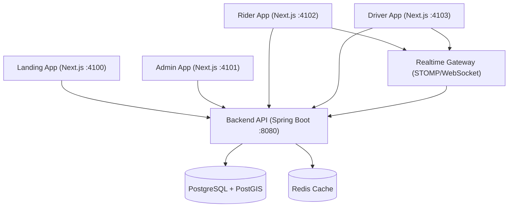

# Velo

> **A full-stack dispatch platform for real-time urban mobility.**
>
> Velo brings rider, driver, and operations workflows into one cohesive system with live ride state, geospatial dispatch, and production-style backend architecture.

## What It Delivers

- End-to-end ride lifecycle: request, match, accept, start, complete
- Dedicated product surfaces for Rider, Driver, Admin, and public web
- Real-time trip updates through WebSocket events
- Multi-tenant-ready backend with geospatial queries and strategy-based pricing

## Product Surfaces

| Surface | Primary Use |
|---|---|
| Landing App | Public product/brand entry point |
| Rider App | Booking, tracking, wallet, promos, notifications |
| Driver App | Onboarding, ride acceptance, live trip progress, earnings |
| Admin App | Dispatch operations, scheduled rides, users/drivers, revenue views |

## System Architecture



## Tech Stack

- Backend: Java 22, Spring Boot, Spring Security, Flyway
- Frontend: Next.js, TypeScript, Turborepo
- Data Layer: PostgreSQL + PostGIS, Redis
- Interface Contracts: REST + OpenAPI (Swagger)
- Realtime Transport: STOMP/WebSocket

## Repository Layout

- `velo-platform/` - backend services, domain model, API, realtime layer
- `velo-frontend/` - monorepo with `landing`, `admin`, `rider`, and `driver` apps
- `docker/` - local infrastructure setup
- `docs/` - project documentation

## Quick Start

```bash
# Backend
cd velo-platform
./mvnw spring-boot:run

# Frontend (new terminal)
cd velo-frontend
npm install
npm run dev
```

Local endpoints:

- Landing: `http://localhost:4100`
- Admin: `http://localhost:4101`
- Rider: `http://localhost:4102`
- Driver: `http://localhost:4103`
- API + Swagger: `http://localhost:8080/swagger-ui/index.html`
