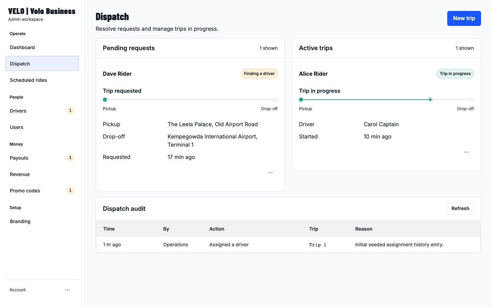
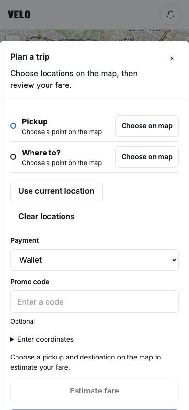
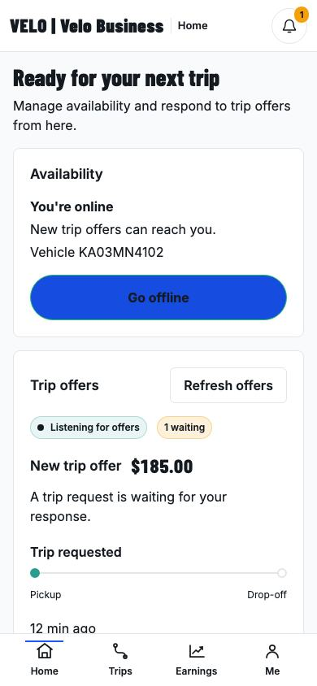
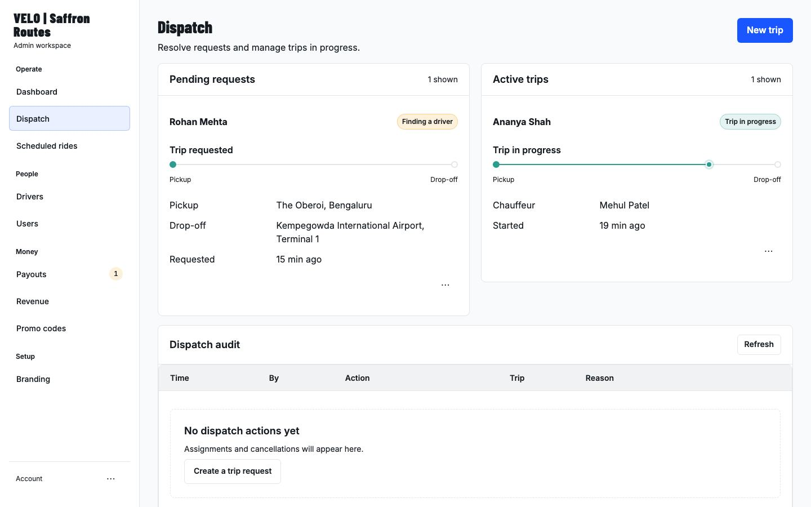
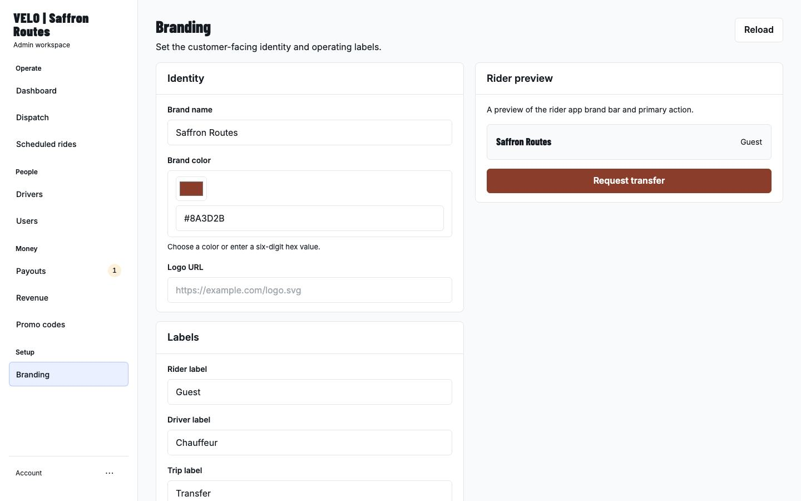
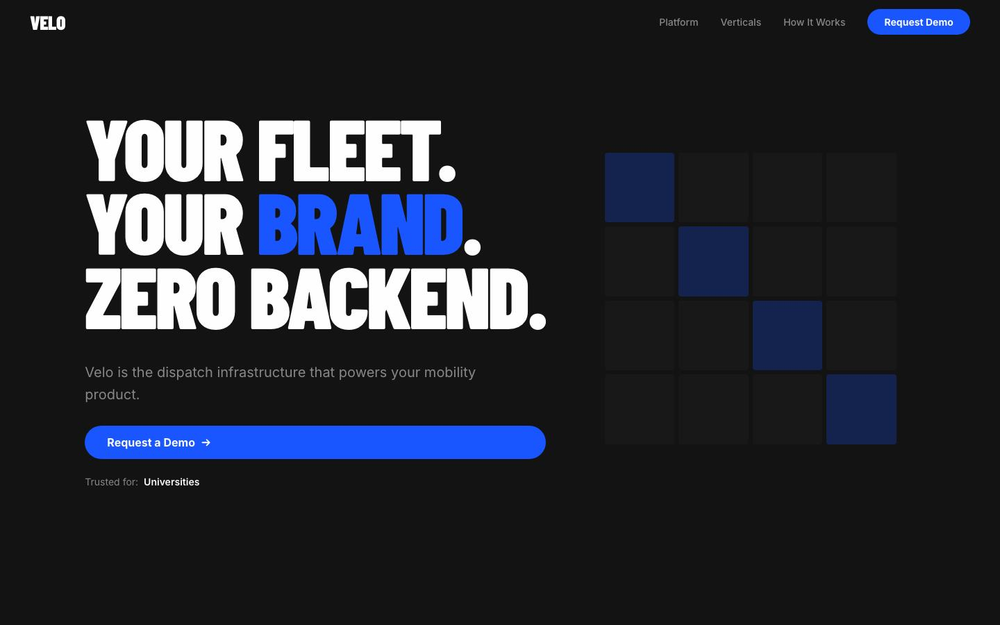
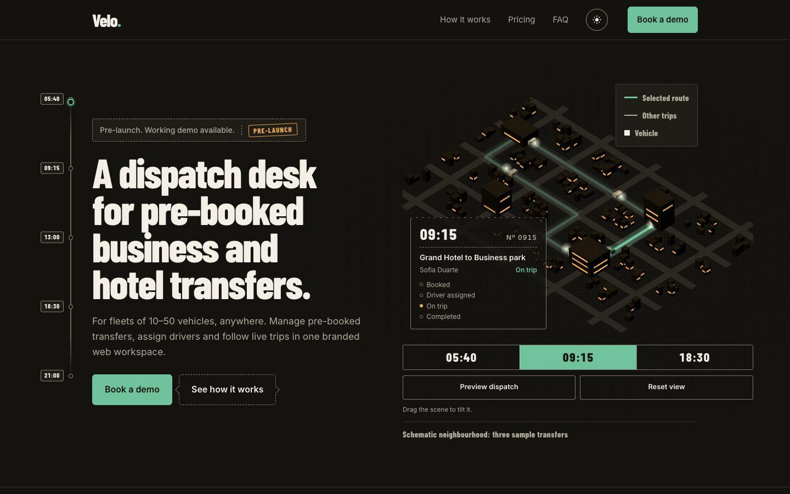
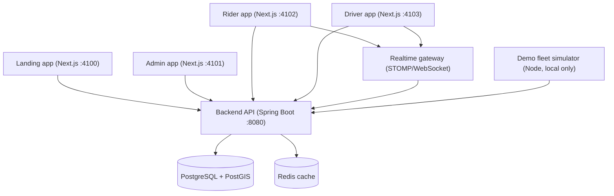

# Velo

> **A white-label dispatch platform for small fleets running pre-booked business and hotel transfers worldwide.**
>
> Each fleet gets its own name, colours, operating labels, currency and tariff, on shared rider, driver and dispatch workflows with live ride state and geospatial matching.

## Demo screenshots

These screens are captured from the local demo at their native viewport sizes.

| Dispatch desk | Rider booking | Driver home |
|---|---|---|
|  |  |  |

| Second tenant dispatch | Second tenant branding settings |
|---|---|
|  |  |

| Landing page — day, 390 × 844 | Landing page — day, 1440 × 900 | Landing page — night, 1440 × 900 |
|---|---|---|
|  |  |  |

## What works today

- **Multi-tenancy:** separate tenant data and branded workspaces, each with its own colours, rider/driver/trip labels, currency, tariff and service area.
- **Rider:** booking with local address search, fare estimates, scheduled and weekly trips, wallet, payment methods, live trip tracking and history.
- **Driver:** availability, trip offers with rider and addresses, pickup OTP, active-trip navigation, earnings and payout requests.
- **Admin:** dispatch with a **live fleet map**, audit history, driver approvals, payouts, scheduled trips, promos and revenue views.
- **Platform:** PostGIS-backed nearby-driver matching, real-time ride updates over STOMP/WebSocket, and cookie-based BFF authentication.
- **Demo:** a **fleet simulator** whose bots drive simulated drivers and riders through the public API. It is directable live from a local control panel or `scripts/demo-sim.sh`, and is fully isolated from real accounts.

## Product surfaces

| Surface | Primary use |
|---|---|
| Landing app | Public product and brand entry point |
| Rider app | Booking, tracking, wallet, promos, notifications |
| Driver app | Onboarding, trip offers, live trip progress, earnings |
| Admin app | Dispatch and live fleet, scheduled trips, users and drivers, revenue |

## System architecture



## Tech stack

- **Backend:** Java 21+, Spring Boot, Spring Security, Flyway.
- **Frontend:** Next.js, TypeScript, Turborepo, Leaflet and OpenStreetMap.
- **Data layer:** PostgreSQL + PostGIS, Redis.
- **Interface contracts:** REST + OpenAPI (Swagger), STOMP/WebSocket.

## Repository layout

- `velo-platform/`: Spring Boot API, domain model, realtime layer, Flyway schema and local demo data.
- `velo-frontend/`: monorepo with the `landing`, `admin`, `rider` and `driver` apps plus shared packages, including `demo-sim`.
- `scripts/`: demo launcher, simulator controls and Docker smoke test.
- `docs/`: product documentation and the decision ledger.

Tenant branding resolves from `default.localhost` or a tenant subdomain such as `saffron-routes.localhost`.

## Quick start

Requirements: Java 21+, Node.js 22+, npm, Python 3, and either local PostgreSQL with PostGIS or Docker.

```bash
./scripts/demo-up.sh
```

On its first run, the script installs frontend dependencies if needed. It then:
- builds production frontends (works offline)
- starts PostGIS through the Compose file only when PostgreSQL is not already reachable
- starts the API, all four web apps and the fleet simulator
- resets the demo tenants to their seeded state

It defaults to ports 4100–4103 and 8080. If those are occupied, it uses 5700–5703 and the next available API port. It prints the tenant URLs, the demo logins and the simulator control URL.

Stop only the services it started with:

```bash
./scripts/demo-down.sh
```

All demo accounts use `password123`.

| Tenant | Admin | Rider | Driver |
|---|---|---|---|
| Velo Business (USD) | `admin@velo-platform.com` | `henry@example.com` | `bob.driver@example.com` |
| Saffron Routes (INR) | `owner@saffronroutes.demo` | `guest@saffronroutes.demo` | `chauffeur1@saffronroutes.demo` |

Use `http://default.localhost:<port>` for Velo Business and `http://saffron-routes.localhost:<port>` for Saffron Routes. The landing page at `http://localhost:4100` uses the default tenant. API docs are at `http://localhost:8080/swagger-ui/index.html`.

See [the two-minute demo storyboard](docs/DEMO_SCRIPT.md) for the click path and the simulator controls (`./scripts/demo-sim.sh preset quiet|steady|busy|airport-rush`, `do <action>`, `pause`, `speed <n>`).

## Tests

Backend suite (use dedicated PostGIS test databases):

```bash
cd velo-platform
./mvnw -B clean test -Dspring.datasource.url=jdbc:postgresql://localhost:5432/testpostgres -Dvelo.test.flyway.url=jdbc:postgresql://localhost:5432/testpostgres_flyway -Dspring.datasource.hikari.maximum-pool-size=2
```

Frontend checks:

```bash
cd velo-frontend
npm ci
npx turbo run lint typecheck test:unit test:contracts build --cache-dir=.turbo-local --concurrency=2
PLAYWRIGHT_ADMIN_BASE_URL=http://127.0.0.1:4101 PLAYWRIGHT_RIDER_BASE_URL=http://127.0.0.1:4102 PLAYWRIGHT_DRIVER_BASE_URL=http://127.0.0.1:4103 npx playwright test
```

Remove `.turbo-local` after running the checks. More detail is in the [docs index](docs/README.md), [architecture](docs/ARCHITECTURE.md), [deployment guide](docs/DEPLOYMENT.md) and [decision ledger](docs/decisions/README.md).
